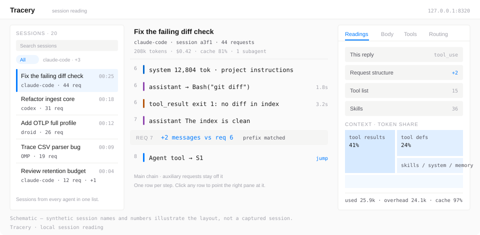
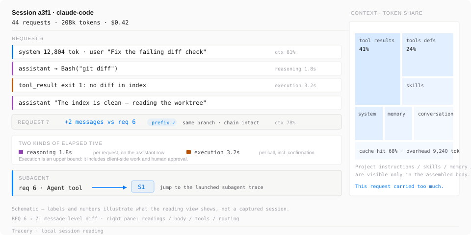
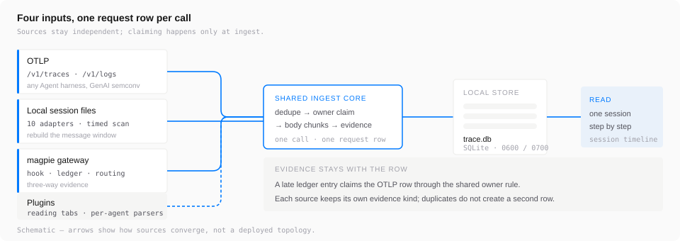
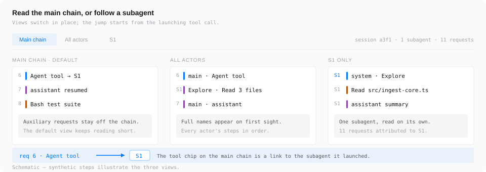
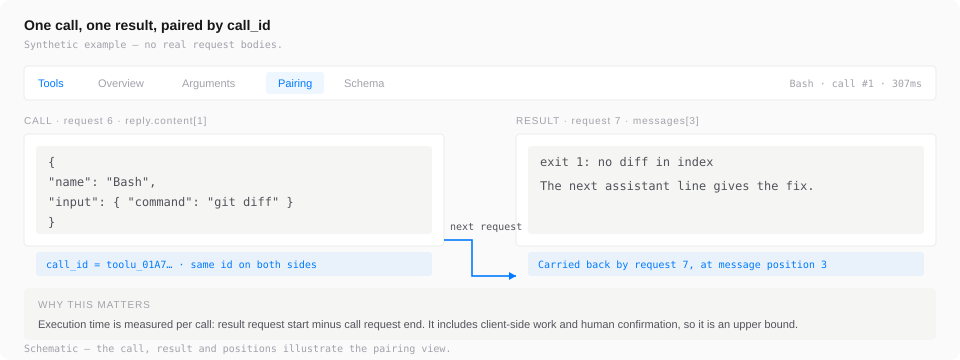
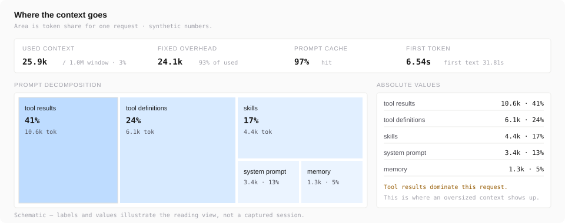

# Tracery

[](https://github.com/PisK4/tracery/actions/workflows/ci.yml)
[](LICENSE)
[](https://bun.sh)
[](package.json)
[](tests)
[](README.zh-CN.md)

**English** ｜ [简体中文](README.zh-CN.md)

**Tracery captures every request an Agent sends, visualizes the full trajectory, and gives agent developers the evidence to debug and iterate on prompts, tools and context.**

A single session fires dozens of LLM calls. Cost and latency tell you how those calls performed. They do not tell you which messages were actually assembled into the request, what project instructions such as `CLAUDE.md`, skills and memory contributed to the system prompt, or what changed between request N and request N-1. Tracery records the assembled request at the point it is sent or exported, then reads those requests back as one session you can walk through line by line.



It sits next to the data path. Nothing is forwarded, rewritten or intercepted. When it isn't running, your agent's requests go through exactly as before.

## Why Tracery

- **Open OTLP, no gateway required.** Point any OTel GenAI exporter at the local endpoint, or let Claude Code, OMP and Codex CLI export in their native shapes. Self-built agents, custom gateways and third-party harnesses follow the same [exporter profile](docs/otlp-exporter-profile.md).
- **One call, one row.** OTLP spans, gateway ledger entries and local session files converge through a shared owner rule. The same call keeps its evidence from every source and stays a single request.
- **Ten local agent formats, zero configuration.** Historical sessions from the agents you already run are scanned and rebuilt into per-call traces, with forks and subagents restored.
- **Everything stays on your machine.** Loopback-only listener, directory 0700, files 0600, credentials redacted by rule, no upload, no third-party runtime dependencies.

## What you get from one session

Three environment variables, one agent session, and the reading view looks like this:



The session header carries call count, token total and cost. Each row in the trace is one step: system and user messages, assistant text, tool calls and results. Request 7 shows a `+2 messages` diff against request 6 with a matched common prefix, so a new branch is distinguishable from a broken chain. Reasoning and execution durations hang on different rows. An Agent tool call links to the subagent it launched. The right pane breaks the prompt down by token area — tool results, tool definitions, skills, system prompt, memory, conversation — which is where you see a request carrying too much context.

Labels and numbers in the diagram are illustrative; real request bodies never enter fixtures, logs or commits.

## Where data comes from



Enable any source, or all of them. Every source writes into the same SQLite database and participates in the same owner claim.

| Source | What it serves | To connect it | What you can read |
| --- | --- | --- | --- |
| **OTLP** | Self-built agents, custom gateways, third-party harnesses; Claude Code, OMP and Codex CLI via their native export shapes | Point the exporter at the local `/v1/traces` and `/v1/logs` endpoints with the generated `otlp.token`; integration partners export GenAI semconv keys and register one stable `service.name` | Full protocol bodies, message-by-message content, tool calls and results, model and usage readings, cross-source claim evidence |
| **Local agent session files** | Ten local agent formats listed below | Nothing to configure; the collector scans their directories on a timer | Historical sessions rebuilt into per-call requests, forks and subagents restored, sessions from all agents in one list |
| **magpie gateway** | Agents routed through [magpie](https://github.com/yetone/magpie) | Register [`integrations/magpie-hook/collector.hooks.ts`](integrations/magpie-hook/collector.hooks.ts) in magpie's plugin config with the generated `hook.token` | The client protocol request body and merged reply, the usage ledger, and routing candidates with the attempt chain |
| **Plugins** | Agent-specific tool shapes | One entry in `src/plugins/registry.ts`, or install a local Parser package | Additional reading tabs in the right pane; community Parsers run in an isolated worker |

OTLP is the general entry point. Its endpoints accept OTLP/HTTP protobuf and JSON, and the profile is built on OTel GenAI semantic conventions with no private keys. A stable `service.name` plus one selection rule is all a new integration costs; the [exporter profile](docs/otlp-exporter-profile.md) holds the contract and its version commitment. Claude Code can also write full bodies to files and put pointers in log events, which Tracery reads in without truncation. Codex CLI reads `[otel.trace_exporter.otlp-http]` in `~/.codex/config.toml` with `protocol = "binary"` instead of the standard environment variables.

The local session adapters:

| Agent | Default root | Environment override | Call unit |
| --- | --- | --- | --- |
| droid (Factory) | `~/.factory/sessions` | `FACTORY_HOME_OVERRIDE` | one assistant message |
| Claude Code | `~/.claude/projects` | `CLAUDE_CONFIG_DIR` | one assistant response (`message.id`, content blocks merged) |
| Codex | `~/.codex/sessions`, `~/.codex/archived_sessions` | `CODEX_HOME` | one response, settled by its usage record; plain and `.jsonl.zst` twins count once |
| DSH | `~/.dsh/sessions` | `DSH_HOME` | one `assistant/message`; seeded forks count inherited parent calls once |
| Hermes | `~/.hermes/state.db` | `HERMES_HOME` | one materialized message row, ordered by `display_order` || Grok | `~/.grok/sessions` | `GROK_HOME` | one assistant line in `chat_history.jsonl` |
| WorkBuddy | `~/.workbuddy` | `WORKBUDDY_CONFIG_DIR` | one `providerData.messageId` group; subagent files fold into the parent |
| Zcode | `~/.zcode/cli/db/db.sqlite` | `ZCODE_HOME` | one assistant message |
| OMP | `~/.omp/agent/sessions`, profiles, and `$XDG_DATA_HOME/omp` | `PI_CONFIG_DIR`, `PI_CODING_AGENT_DIR`, `PI_CODING_AGENT_SESSION_DIR`; `OMP_HOME` as legacy | one assistant message |
| Pi | `~/.pi/agent/sessions`, custom agent dir, and `settings.json` `sessionDir` | `PI_CODING_AGENT_DIR`, `PI_CODING_AGENT_SESSION_DIR`; `PI_HOME` as legacy | one assistant message |

A 60-second tick discovers all adapters; recent files get priority and one adapter at a time backfills history. One adapter failing freezes only that agent. The request body is rebuilt from the messages up to that call, and the reply is that call's content. The page labels the source per agent, so a trace from a session file always reads as one.

## Quick start

Requires [Bun](https://bun.sh) ≥ 1.4. SQLite is `bun:sqlite` and compression is `node:zlib`; there are no other runtime dependencies.

### Record real traffic

```sh
bun install
bun run start        # collector on 127.0.0.1:8320
```

Open `http://127.0.0.1:8320`. On first start the collector creates `read.token`, `hook.token`, `otlp.token` and `redaction.salt` in the data directory — file mode 0600, directory mode 0700. The default data directory is `~/Library/Application Support/tracery` on macOS and `${XDG_DATA_HOME:-~/.local/share}/tracery` elsewhere. macOS and Linux are supported; Windows is not, because the file-mode checks the collector relies on do not apply there.

For OTLP, the token file holds 32 raw bytes. Export its base64url form — `cat`-ing the file puts non-ASCII bytes into `Authorization` and the request is rejected as malformed at the HTTP layer:

```sh
ATC_TOKEN=$(base64 -i '<dataDir>/otlp.token' | tr '+/' '-_' | tr -d '\n=')
export OTEL_EXPORTER_OTLP_ENDPOINT=http://127.0.0.1:8320
export OTEL_EXPORTER_OTLP_HEADERS="authorization=Bearer $ATC_TOKEN"
```

For per-request bodies on Claude Code, also set `OTEL_LOG_RAW_API_BODIES=file`. Local session files need no setup at all: sessions already on disk appear in the list after the next scan. All sources can run at once.

Override paths and limits with `ATC_DATA_DIR`, `ATC_PORT`, `ATC_LEDGER_PATH`, `ATC_ROUTING_DIR`, `ATC_MAGPIE_URL`, `ATC_BODY_BUDGET`, `ATC_DISK_LIMIT`. The listen address is hard-coded to loopback.

### Look at the interface first (synthetic data)

```sh
bun install
bun prototypes/synthetic-server.ts
```

Open `http://127.0.0.1:8770/?session=conv-synthetic-reading`. The synthetic server covers empty states, windowed pagination, missing channels and turn pairing. It binds loopback only, never touches a real database and never reads a token.

## Reading a trace

The middle pane is one row per step: protocol lines first — system prompt (including fields like `cc_version` and `anthropic-beta`), user prompt, environment injection — then assistant text and tool calls. Calls and results are separate rows, paired by `call_id` and message position. Title generation and classifier calls stay off the main chain as auxiliary requests; the formal title computed by a title-generation request is used by the main session.

Sub-agents share the main session's `conv_key` and group separately per `actor`. The reading view defaults to the main chain and offers all-actors and per-`S#` views; an Agent tool call links to the subagent it launched, and the trace list marks subagent sessions. The session header shows how many sub-agents ran and how many requests each made.



Clicking any row points the right pane at that step's protocol source. Its tabs are readings (this reply, request structure, capability list, usage and context, identity integrity), body (raw messages, 40 per page), tools (overview, arguments, pairing and schema for the selected call), routing (candidate order and attempt chain), and the Plugin tabs. The [Plugin developer guide](docs/plugin-guide.md) covers the author contract and the two contribution paths available today.



The pairing tab shows a call's JSON and its result body under the same `call_id`, and notes which later request carried the result back.

### Two kinds of elapsed time

- **Execution segment** hangs on the tool call row and is measured per call: the result request's start minus the call request's end. It includes client-side processing and human confirmation, so it is an upper bound.
- **Reasoning segment** hangs on the assistant text row and belongs to the whole request: first text minus first token (`reasoning_span_ms`). When a request has several text blocks, each shows the same number.

Reasoning is per request and is not split per tool. The UI tells you how long the request carrying the call reasoned, on that request's assistant row and in the readings pane.

### Where the context goes

The readings tab lays this request's prompt decomposition out as a token-area treemap: tool definitions, skills, system prompt, memory, conversation content, tool results. Area is token share; the list below gives absolute values and percentages, alongside used context, window size, fixed overhead and cache hit rate.



### Multiple agents, one set of views

The session list holds sessions from different harnesses, with an Agent tag for distinction and filtering, a full-database agent directory, and per-agent visibility filters. When a session involves several agents, the row shows the primary agent and `+N`. Adding a harness costs one stable `service.name` plus one selection rule.

## What records, and where it lives

Tracery stores real request bodies: prompts, code, tool output and model replies, with credentials redacted by rules, in a local SQLite database on your machine.

| | |
| --- | --- |
| Data directory | `~/Library/Application Support/tracery` on macOS, `${XDG_DATA_HOME:-~/.local/share}/tracery` elsewhere (override with `ATC_DATA_DIR`) |
| Contents | `trace.db` plus WAL, the four token/salt files, and logs |
| Permissions | directory 0700, files 0600 |
| Network | listens on `127.0.0.1` only, hard-coded; never a wildcard address |
| Outbound | reads magpie's local ledger and routing files, the local session files of the agents above, and probes magpie's local port. Nothing is uploaded |
| Accounts | account fields are kept out of the API surface |
| Retention | bodies are reclaimed against a budget: 10 GB of bodies, 16 GB total. At 90% of budget the oldest bodies are reclaimed; at 80% of disk only metadata is accepted; at 95% ingestion stops. Reclaimed bodies cannot be restored |

On the OTLP path the only file read outside the database is a `body_ref` — a single file an event points at explicitly, never a directory listing. Tests use synthetic data only; real request bodies, accounts, tokens and user configuration never enter fixtures, logs or commits.

## How this differs from an observability platform

"Isn't this just Langfuse?" is the most common question on opening this repo. Both look at LLM traffic, and they answer different questions. A platform's unit is an LLM call or span: `input` / `output` text, latency, cost, scores — how is the application I built performing. Tracery's unit is the assembled protocol object captured at the point of send or export — what actually happened in this session.

| Dimension | What Tracery gives you | What a platform's hook usually sees |
| --- | --- | --- |
| Unit of record | The full protocol object, message by message | One call collapsed into input and output text |
| Assembled context | Project instructions (`CLAUDE.md` and equivalents), skills, memory and tool results laid out by token area | Conversation and tool calls; Langfuse's own [integration docs](https://langfuse.com/resources/engineering/coding-agent-tracing) note that hooks cannot see the auto-loaded contribution to the real system prompt |
| Change between requests | Semantic fingerprints compare common prefixes, so a new branch is distinguishable from a broken chain | Per-call payloads, no sequence comparison |
| Evidence consistency | Several sources converge on one owner row, with each source's evidence kept | A single source |
| Sub-agents | Main chain and per-`S#` views, with a jump from the launching tool call | Traces laid out by hierarchy |
| Data location | Every body stays on the local machine | Reported to a service |

Evaluation, datasets, collaboration, aggregate dashboards and alerting belong to the platform. Both can run at once: same traffic, cost trends on the platform side, "what happened in this session" on the machine.

## Scope and non-goals

- **Observed traffic only.** Requests that arrive through neither OTLP, the gateway, nor a scanned local session file are invisible. Request counts are bounded by what was observed.
- **Not a proxy.** Nothing is forwarded, rewritten or intercepted.
- **OTLP is the general ingestion protocol.** Other generic trace protocols are out of scope.
- **Local by design.** No export, alerting, dashboards or multi-machine aggregation; in-page search filters the session titles and client labels already loaded.
- **Request-level reading, not evaluation.** Outputs are not scored and prompt versions are not managed.

## Commands

```sh
bun install
bun run start             # collector, 127.0.0.1:8320
bun test
bun run typecheck
bun run maintain <cmd>    # offline maintenance: backup, restore, verify, dedupe, otlp-replay, rebuild, reparse, capacity; requires the collector to be stopped
bun run service <cmd>     # start/stop/status via launchd (macOS only)
bun run verify:notes      # change-note gate, maintainer use
```

`service` and `maintain` require a subcommand; invoked bare they print usage and exit 2.

The production instance on the author's machine runs under launchd with `KeepAlive`; `bun run service` manages that setup and is macOS-specific. On other platforms, run `bun run start` under your own process supervisor.

## Documentation

All design documents are written in Chinese. The [glossary](GLOSSARY.md) pairs each term with its English form.

- [ATC trace format](docs/trace-format.md) — main entities, body chunking, derived conclusions and confidence
- [Architecture](docs/architecture-design.md) — evidence identity, storage model, derivation, capacity, security boundary
- [Operations](docs/operations.md) — maintenance commands, backup and restore, capacity thresholds
- [OTLP exporter profile](docs/otlp-exporter-profile.md) — the contract for harness authors
- [Plugin developer guide](docs/plugin-guide.md) — the plugin contract, admission criteria, the two contribution paths available today, and the planned feature-package form
- [Acceptance record](docs/acceptance.md) — per-round validation against synthetic and real traffic
- [Project positioning](docs/project-overview.md) — why the unit is a request and the reading unit is a session
- [Glossary](GLOSSARY.md)
- [Documentation index](docs/README.md)
- [Demo and synthetic scenarios](prototypes/README.md)
- [Agent notes: rules and decision records](.agents/notes/README.md)

## Contributing

Issues and pull requests are welcome — read [CONTRIBUTING.md](CONTRIBUTING.md) first. Two conventions are unusual enough to mention up front:

- **Agent notes.** Any non-trivial change ships with a note under [`.agents/notes/`](.agents/notes/README.md) recording the decision, what was rejected, and what it cost. `bun run verify:notes` checks this before a merge. Purely mechanical or local edits are exempt.
- **Read the working agreements first.** [AGENTS.md](AGENTS.md) states the module boundaries and the standing conventions the test suite enforces.

Run `bun run typecheck` and `bun test` before opening a pull request; CI runs both.

Security issues go through [SECURITY.md](SECURITY.md), never a public issue. Changes are tracked in the [changelog](CHANGELOG.md).

## License

MIT — see [LICENSE](LICENSE).
