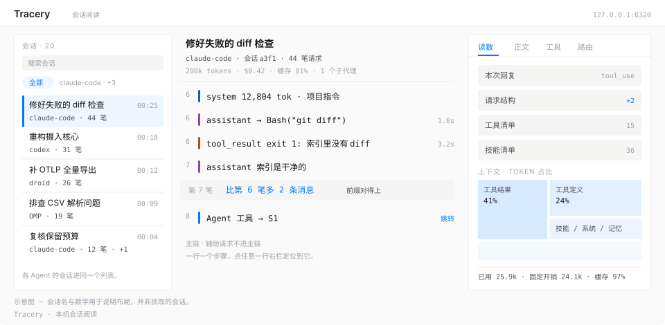
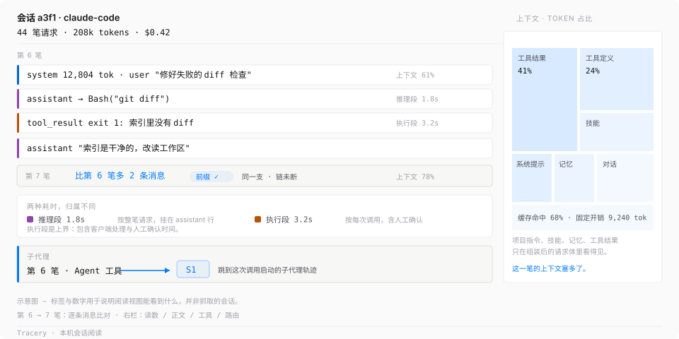
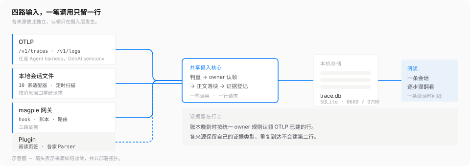
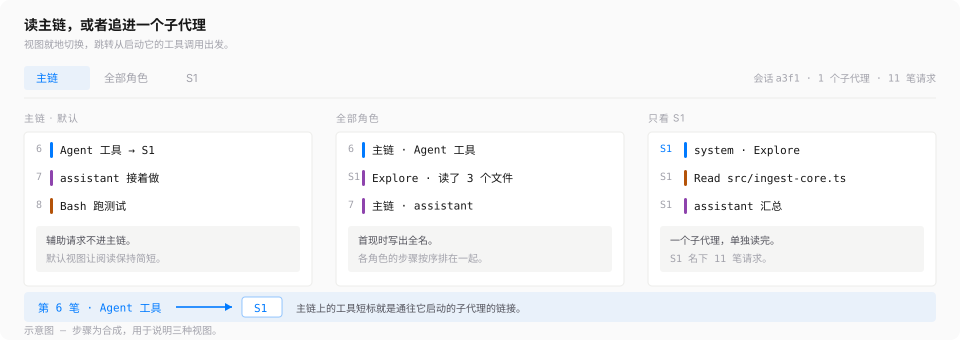
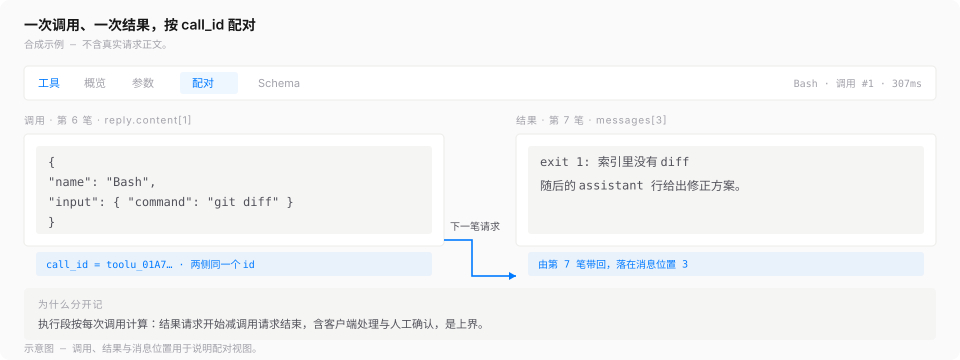
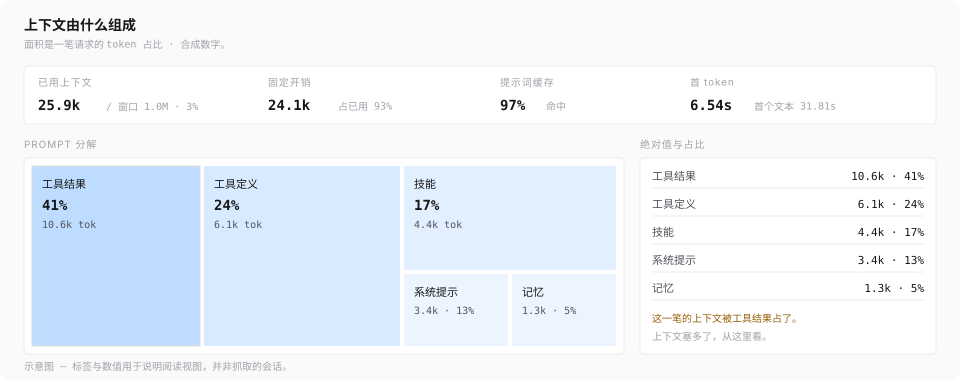

# Tracery

[](https://github.com/PisK4/tracery/actions/workflows/ci.yml)
[](LICENSE)
[](https://bun.sh)
[](package.json)
[](tests)
[](README.md)

[English](README.md) ｜ **简体中文**

**Tracery 记录 Agent 发出的每笔请求，把整条轨迹可视化，给 Agent 开发者提供调试与迭代 prompt、工具、上下文的依据。**

一次 Agent 会话要发几十笔 LLM 调用。成本与耗时告诉你这些调用跑得怎么样，不告诉你请求体里组装了哪几条消息、项目指令（如 `CLAUDE.md`）、技能与记忆给 system prompt 添了什么、第 N 笔比第 N-1 笔多了什么。Tracery 在请求发出或导出的位置留完整请求，再按会话把这些请求读回成一条可以逐行翻看的时间线。



它挂在数据面旁边。不转发、不改写、不拦截。没运行时，Agent 的请求照常走完。

## 为什么用 Tracery

- **OTLP 开放接入，不依赖网关。** 把任意 OTel GenAI exporter 指到本机端点即可；Claude Code、OMP 与 Codex CLI 按各自原生导出形状兼容。自研 Agent、自研网关、第三方 harness 都照同一份[接入 profile](docs/otlp-exporter-profile.md) 导出。
- **一笔调用只留一行。** OTLP span、网关账本与本地会话文件走同一条 owner 认领规则，同一笔调用留下各来源的证据，仍只算一笔请求。
- **10 种本机会话格式，零配置。** 已经在用的 Agent 留下的历史会话，扫描后重建为逐笔轨迹，fork 与子代理一并还原。
- **数据全部留在本机。** 只监听回环，目录 0700、文件 0600，凭证按规则脱敏，零上传，零第三方运行时依赖。

## 一次会话能读到什么

三行环境变量，跑一轮 Agent 会话，阅读视图里就是下面这些：



会话头给出笔数、token 总量与费用。中栏一行一个步骤：system 与 user 消息、assistant 文本、工具调用与结果。第 7 笔标出比第 6 笔多 2 条消息，共同前缀对得上，于是「另起一支」与「链断了」可以分开判断。推理段与执行段挂在不同行上。Agent 工具调用能跳到它启动的子代理。右栏把 prompt 按 token 面积铺开——工具结果、工具定义、技能、系统提示、记忆、对话内容——一次请求是不是塞多了上下文，从这里看。

图中标签与数字是示意，真实请求正文不进 fixture、日志或提交。

## 数据从哪里来



各条通道可以单独开，也可以同时开，写进同一个 SQLite 库，按同一条 owner 规则认领。

| 来源 | 适配对象 | 接入要做什么 | 能读到什么 |
| --- | --- | --- | --- |
| **OTLP** | 自研 Agent、自研网关、第三方 harness；Claude Code、OMP、Codex CLI 按原生导出形状兼容 | exporter 指向本机 `POST /v1/traces` 与 `POST /v1/logs`，认证用生成的 `otlp.token`；集成方按 GenAI semconv 导出并登记一个稳定的 `service.name` | 完整协议正文、逐条消息、工具调用与结果、模型与用量读数、跨来源认领证据 |
| **本地 Agent 会话文件** | 下表 10 种本机会话格式 | 无需配置，定时扫描各自目录 | 历史会话重建为逐笔请求，fork 与子代理还原，各 Agent 的会话进同一个列表 |
| **magpie 网关** | 经过 [magpie](https://github.com/yetone/magpie) 路由的 Agent | 把 [`integrations/magpie-hook/collector.hooks.ts`](integrations/magpie-hook/collector.hooks.ts) 注册进 magpie 插件配置，配上生成的 `hook.token` | 客户端协议请求体与合并回复、用量账本、路由候选与尝试链 |
| **Plugin** | 各家 Agent 的工具形状 | 在 `src/plugins/registry.ts` 加一项，或装本地 Parser 包 | 右栏新增阅读页签，社区 Parser 在隔离 Worker 里运行 |

OTLP 是通用入口。端点收 OTLP/HTTP 的 protobuf 与 JSON，profile 全部站在 OTel GenAI 语义约定之上，不发明私有键。新集成方的成本是一个稳定的 `service.name` 加一行选取规则，契约与版本承诺在[接入 profile](docs/otlp-exporter-profile.md)。Claude Code 还能把完整正文写成文件、在 log 事件里带指针，采集器按指针读入，正文完整不截断。Codex CLI 不读标准环境变量，在 `~/.codex/config.toml` 配 `[otel.trace_exporter.otlp-http]` 指向本机端点，`protocol` 写 `binary`。

本地会话适配器：

| Agent | 默认根 | 环境变量覆盖 | 调用单位 |
| --- | --- | --- | --- |
| droid（Factory） | `~/.factory/sessions` | `FACTORY_HOME_OVERRIDE` | 一条 assistant 消息 |
| Claude Code | `~/.claude/projects` | `CLAUDE_CONFIG_DIR` | 一次 assistant 回复（`message.id`，内容块合并） |
| Codex | `~/.codex/sessions`、`~/.codex/archived_sessions` | `CODEX_HOME` | 一次回复，由 usage 记录结算；明文与 `.jsonl.zst` 双份只算一次 |
| DSH | `~/.dsh/sessions` | `DSH_HOME` | 一条 `assistant/message`；带种子的 fork 只继承父调用一次 |
| Hermes | `~/.hermes/state.db` | `HERMES_HOME` | 一条物化消息行，按 `display_order` 排序 |
| Grok | `~/.grok/sessions` | `GROK_HOME` | `chat_history.jsonl` 里的一条 assistant 行 |
| WorkBuddy | `~/.workbuddy` | `WORKBUDDY_CONFIG_DIR` | 一个 `providerData.messageId` 组；子代理文件折进父会话 |
| Zcode | `~/.zcode/cli/db/db.sqlite` | `ZCODE_HOME` | 一条 assistant 消息 |
| OMP | `~/.omp/agent/sessions`、profiles 与 `$XDG_DATA_HOME/omp` | `PI_CONFIG_DIR`、`PI_CODING_AGENT_DIR`、`PI_CODING_AGENT_SESSION_DIR`；`OMP_HOME` 为旧值 | 一条 assistant 消息 |
| Pi | `~/.pi/agent/sessions`、自定义 agent 目录与 `settings.json` 的 `sessionDir` | `PI_CODING_AGENT_DIR`、`PI_CODING_AGENT_SESSION_DIR`；`PI_HOME` 为旧值 | 一条 assistant 消息 |

每 60 秒发现一次所有适配器，最近文件优先，历史按一家一轮回补。某一家适配器出错只冻结这一家。请求体由截至该轮的消息重建，回复取该轮内容。页面按 Agent 标注来源，来自会话文件的轨迹始终读成一条时间线。

## 快速开始

需要 [Bun](https://bun.sh) ≥ 1.4。SQLite 用 `bun:sqlite`，压缩用 `node:zlib`，没有其他运行时依赖。

### 接真实流量

```sh
bun install
bun run start        # 采集器，127.0.0.1:8320
```

打开 `http://127.0.0.1:8320`。首次启动在数据目录生成 `read.token`、`hook.token`、`otlp.token` 与 `redaction.salt`，权限 0600，目录 0700。默认数据目录在 macOS 上是 `~/Library/Application Support/tracery`，其他平台是 `${XDG_DATA_HOME:-~/.local/share}/tracery`。支持 macOS 与 Linux；不支持 Windows，采集器依赖的文件权限位在 Windows 上不成立。

OTLP 令牌文件是 32 字节裸二进制，环境变量里放它的 base64url 形式。直接 `cat` 文件会把非 ASCII 字节塞进 `Authorization`，请求在 HTTP 层就被判畸形：

```sh
ATC_TOKEN=$(base64 -i '<dataDir>/otlp.token' | tr '+/' '-_' | tr -d '\n=')
export OTEL_EXPORTER_OTLP_ENDPOINT=http://127.0.0.1:8320
export OTEL_EXPORTER_OTLP_HEADERS="authorization=Bearer $ATC_TOKEN"
```

Claude Code 要逐笔正文再加 `OTEL_LOG_RAW_API_BODIES=file`。本地会话文件不需要任何设置，磁盘上已有的会话在下一轮扫描后出现在列表里。各条通道可以同时开。

路径与限额可用 `ATC_DATA_DIR`、`ATC_PORT`、`ATC_LEDGER_PATH`、`ATC_ROUTING_DIR`、`ATC_MAGPIE_URL`、`ATC_BODY_BUDGET`、`ATC_DISK_LIMIT` 覆盖。监听地址写死回环。

### 先看界面（合成数据）

```sh
bun install
bun prototypes/synthetic-server.ts
```

打开 `http://127.0.0.1:8770/?session=conv-synthetic-reading`。合成服务覆盖空状态、窗口分页、缺通道与轮次配对等场景；只监听回环，不连真实库，不读令牌。

## 阅读一条 trace

中栏一行一个步骤：开头是协议层——system prompt（连同 `cc_version`、`anthropic-beta` 这类字段）、user prompt、环境注入——随后是 assistant 文本与工具调用。调用与结果各自成行，按 `call_id` 与消息位置配对。标题生成、分类器这类旁路请求标成辅助请求，不进主链；标题生成请求算出的正式标题由主会话使用。

子代理与主会话共用 `conv_key`，按 `actor` 各自成组。阅读视图默认只看主链，可切到全部角色或按 `S#` 单看某个子代理；Agent 工具调用能跳到它启动的子代理，会话列表也会标出子代理会话。会话头给出子代理个数与各自笔数。



点任意一行，右栏定位到该步骤的协议来源。页签有读数（本次回复、请求结构、能力清单、用量与上下文、身份完整性）、正文（原始消息，按 40 条一片翻页）、工具（选中一次调用后有概览、参数、配对、Schema 四页）、路由（候选顺序与尝试链），以及 Plugin 页签。[Plugin 开发者指引](docs/plugin-guide.md) 写明作者契约与今天可用的两条贡献路径。



配对页把同一个 `call_id` 的调用 JSON 与结果正文同屏并置，并注明结果由哪一笔请求带回、落在什么消息位置。

### 推理段与执行段

- **执行段**挂在工具调用行上，按每次调用计算：结果请求开始减调用请求结束。它含客户端处理与人工确认，是上界。
- **推理段**挂在 assistant 文本行上，属于整笔请求：首个文本减首 token（`reasoning_span_ms`）。同一笔请求有多段文本时，每段标同一个数。

推理是请求级的，不按工具拆分。承载这次工具调用的请求推理了多久，在同一笔的 assistant 行与右栏读数里看。

### 上下文由什么组成

右栏读数把这一笔请求的 prompt 分解按 token 面积铺成上下文矩阵：工具定义、技能、系统提示、记忆、对话内容、工具结果各占一块，面积就是 token 占比，下方列表给出每类的绝对值与百分比，同一张卡还有已用上下文、窗口总量、固定开销与缓存命中。



### 多 Agent，同一套视图

左栏会话列表装不同 harness 的会话，用 Agent 标签区分与过滤，带全库 Agent 目录与按 Agent 的可见性筛选；同一会话涉及多个 Agent 时，行上显示主 Agent 与 `+N`。新增 harness 的成本是一个稳定的 `service.name` 加一行选取规则。

## 记录什么，存在哪

Tracery 存的是真实请求正文：prompt、代码、工具输出与模型回复，凭证按规则脱敏，都落在本机 SQLite 库里。

| | |
| --- | --- |
| 数据目录 | macOS 为 `~/Library/Application Support/tracery`，其他平台为 `${XDG_DATA_HOME:-~/.local/share}/tracery`（可用 `ATC_DATA_DIR` 覆盖） |
| 内容 | `trace.db` 与 WAL、四个令牌与盐文件、日志 |
| 权限 | 目录 0700，文件 0600 |
| 网络 | 只监听 `127.0.0.1`，写死；不接受通配地址 |
| 外发 | 读取 magpie 的本机账本与路由文件、上表各 Agent 的本机会话文件，探测 magpie 的本机端口。不上传任何内容 |
| 账号字段 | 不出接口 |
| 回收 | 正文按预算回收：正文 10 GB、总盘 16 GB。正文到 90% 预算时回收最旧的，总盘到 80% 只接元数据，到 95% 停止接收。回收的正文补不回来 |

OTLP 通道上唯一的文件读取是 `body_ref`，只读事件显式指到的单个文件，不列目录。测试只用合成数据，真实请求正文、账号、令牌与用户配置不进 fixture、日志或提交。

## 与观测平台的分工

「这不就是 Langfuse 吗」是打开这个仓库时最常见的疑问。两者都在看 LLM 流量，回答的问题不同。平台的记录单位是一次 LLM 调用或一个 span：`input` / `output` 两段文本、耗时、成本、评分，用来回答「我写的应用表现如何」。Tracery 的记录单位是在发送点或导出点捕获的组装后协议对象，用来回答「这次会话到底发生了什么」。

| 维度 | Tracery 能给出的 | 平台 hook 通常看到的 |
| --- | --- | --- |
| 记录单位 | 完整协议对象，逐条消息可还原 | 一次调用收敛成 input 与 output 两段文本 |
| 组装后的上下文 | 项目指令（`CLAUDE.md` 一类）、技能、记忆、工具结果按 token 面积铺开 | 对话与工具调用；Langfuse 在[自己的集成文档](https://langfuse.com/resources/engineering/coding-agent-tracing)里写明，hook 读不到自动加载内容对实际 system prompt 的贡献 |
| 请求间变化 | 语义指纹比共同前缀，能区分另一支与断链 | 一次调用一份载荷，不做序列比对 |
| 证据一致性 | 多来源认领到同一行 owner，各来源证据都留着 | 单一来源 |
| 子代理 | 主链与按 `S#` 的视图，从启动它的工具调用跳转 | 按 trace 层级平铺 |
| 数据位置 | 每份正文都留在本机 | 上报到服务端 |

评测、数据集、多人协作、聚合仪表盘与告警归平台。两边可以同时开：同一批请求，平台侧看成本趋势，本机侧读这次会话到底发生了什么。

## 边界与非目标

- **只记录观察到的流量。** 不经 OTLP、网关，也不在扫描到的本地会话文件里的请求看不见，请求统计以已保存的观测范围为限。
- **不做代理。** 不转发、不改写、不拦截任何 LLM 流量。
- **OTLP 是唯一的通用摄入入口。** 其余通用 trace 协议不做。
- **按本机设计。** 不做导出、告警、指标看板与多机聚合；页面搜索只按会话标题与客户端标签过滤已加载列表。
- **做请求级阅读，不做评测。** 不打分，不管理提示词版本。

## 命令

```sh
bun install
bun run start            # 采集器，127.0.0.1:8320
bun test
bun run typecheck
bun run maintain <子命令> # 离线维护：backup、restore、verify、dedupe、otlp-replay、rebuild、reparse、capacity；要求采集器已停
bun run service <子命令>  # 起停与状态，走 launchd（仅 macOS）
bun run verify:notes      # 变更 note 闸门，维护者用
```

`service` 与 `maintain` 必须带子命令，裸调用只打印 usage 并退出 2。

生产实例由 launchd 以 `KeepAlive` 托管，`bun run service` 管理这套部署，仅限 macOS。其他平台用 `bun run start` 挂到自己的进程管理器下。

## 文档

- [ATC trace 格式](docs/trace-format.md)：主实体、正文切块、派生结论与置信度
- [架构设计](docs/architecture-design.md)：证据身份、存储模型、派生、容量与安全边界
- [运维手册](docs/operations.md)：维护命令、备份恢复、容量门槛
- [OTLP exporter 接入 profile](docs/otlp-exporter-profile.md)：harness 作者的对接规范与登记方式
- [Plugin 开发者指引](docs/plugin-guide.md)：准入判据、今天可用的两条贡献路径、本地 Feature 包的形态
- [验收记录](docs/acceptance.md)：各轮合成与真实流量的验收结果
- [项目定位](docs/project-overview.md)：记录单位与阅读入口的取舍
- [领域术语表](GLOSSARY.md)：术语定义与边界
- [文档索引](docs/README.md)
- [Demo 与合成场景](prototypes/README.md)
- [Agent Note 规则与决策记录](.agents/notes/README.md)

## 参与

欢迎提 issue 与 pull request，动笔前先读 [CONTRIBUTING.md](CONTRIBUTING.md)。两条约定不太常见，先说在前面：

- **Agent Note。** 非平凡改动要附一篇 [`.agents/notes/`](.agents/notes/README.md) 下的 note，记下决策、否决了什么、代价是什么；`bun run verify:notes` 在合并前检查这一条。纯机械或局部编辑豁免。
- **先读工作约定。** [AGENTS.md](AGENTS.md) 写明模块边界与测试守住的常备约定。

提交 pull request 前跑 `bun run typecheck` 与 `bun test`；CI 也跑这两项。

安全问题走 [SECURITY.md](SECURITY.md)，不要开公开 issue。变更记在 [CHANGELOG](CHANGELOG.md)。

## 许可

MIT，见 [LICENSE](LICENSE)。
